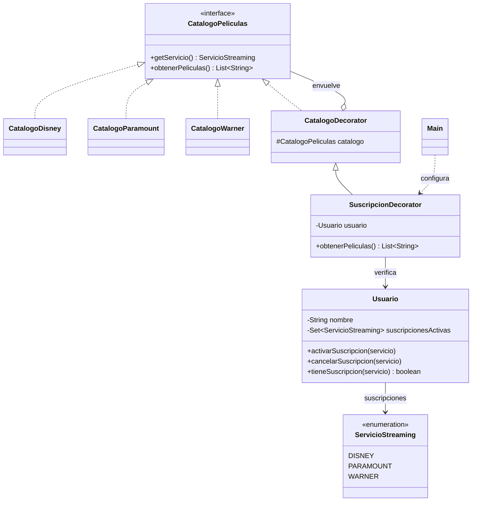

# Ejercicio: Patrón Decorator en Java

Práctica de Implementación de Sistemas sobre el patrón de diseño Decorator. Se controla el acceso a catálogos de películas (Disney, Paramount y Warner) según las suscripciones activas de cada usuario.

## Contexto del problema

Una plataforma ofrece catálogos de películas de tres servicios. Cada usuario puede tener distintas suscripciones activas y solo debe consultar los catálogos incluidos en ellas. Poner la lógica de acceso dentro de cada catálogo mezcla responsabilidades, y crear una subclase por cada combinación de catálogo y suscripción produciría demasiadas clases. Con Decorator, un catálogo se envuelve con una capa que verifica el acceso y mantiene la misma interfaz.

## Estructura

```
practica-06-decorator-java/
├── CatalogoPeliculas.java       # Componente (interfaz)
├── CatalogoDisney.java          # Componentes concretos
├── CatalogoParamount.java
├── CatalogoWarner.java
├── CatalogoDecorator.java       # Decorador base
├── SuscripcionDecorator.java    # Decorador concreto: verifica la suscripción
├── ServicioStreaming.java       # Enum de servicios
├── Usuario.java                 # Suscripciones del usuario
├── Main.java                    # Cliente de demostración
└── README.md
```

## Requisitos

- JDK 9 o superior (el código usa `List.of`). Comprueba con `java --version` y `javac --version`.

## Compilar y ejecutar

Desde la raíz de la carpeta:

```bash
javac *.java
java Main
```

## Solución paso a paso

| Paso | Clase | Qué hace |
|---|---|---|
| 1 | `CatalogoPeliculas` | Interfaz común: `getServicio()` y `obtenerPeliculas()` |
| 2 | `CatalogoDisney`, `CatalogoParamount`, `CatalogoWarner` | Componentes concretos que devuelven sus películas |
| 3 | `CatalogoDecorator` | Clase abstracta que implementa la interfaz, guarda un `CatalogoPeliculas` y delega en él |
| 4 | `SuscripcionDecorator` | Antes de delegar, comprueba si el usuario tiene la suscripción; si no, lanza `IllegalStateException` |
| 5 | `ServicioStreaming` y `Usuario` | Enum de servicios y un `Set` de suscripciones activas con activar, cancelar y consultar |

`Main` envuelve cada catálogo una sola vez con `SuscripcionDecorator` y después cambia las suscripciones de Ana para comprobar que el resultado cambia sin reemplazar ningún catálogo.

## Resultado

```
=== Ana tiene Disney y Warner ===
[ACCESO PERMITIDO] Disney: [El rey leon, Toy Story, Frozen]
[ACCESO PERMITIDO] Warner: [Harry Potter, Batman, Duna]
[ACCESO DENEGADO] Ana no tiene activa la suscripcion de Paramount

=== Ana activa Paramount ===
[ACCESO PERMITIDO] Paramount: [Top Gun: Maverick, Sonic, Un lugar en silencio]

=== Ana cancela Disney ===
[ACCESO DENEGADO] Ana no tiene activa la suscripcion de Disney
```

## Pruebas

| Comprobación | Evidencia en la salida |
|---|---|
| Una suscripción activa permite consultar las películas | Disney y Warner: `ACCESO PERMITIDO` |
| Sin suscripción se informa que el acceso fue denegado | Paramount (antes de activarlo) y Disney (tras cancelarlo): `ACCESO DENEGADO` |
| Activar una suscripción cambia el resultado sin reemplazar el catálogo | El mismo objeto `paramount` pasa de denegado a permitido |
| Catálogos y decorador se usan por la misma interfaz | `consultar(CatalogoPeliculas)` recibe siempre objetos decorados |

## Preguntas de análisis

**¿Qué responsabilidad añade `SuscripcionDecorator` al catálogo que envuelve?**
Añade el control de acceso: antes de entregar las películas comprueba que el usuario tenga activa la suscripción del servicio y, si no, deniega la consulta. El catálogo envuelto solo sabe devolver películas; la regla de quién puede verlas queda fuera de él.

**¿Por qué `CatalogoDecorator` guarda una referencia de tipo `CatalogoPeliculas` y no de una clase concreta?**
Porque así puede envolver cualquier catálogo (Disney, Paramount, Warner o uno futuro) e incluso otro decorador, lo que permite apilar capas (por ejemplo, una de suscripción y otra de control parental). Depender de la interfaz y no de una clase concreta mantiene el bajo acoplamiento y respeta el principio de inversión de dependencias.

**¿Qué ventaja tiene comprobar la suscripción al consultar el catálogo, en vez de generar una clase para cada combinación de suscripciones?**
Con solo tres servicios ya existen ocho combinaciones posibles de suscripciones, y cada servicio nuevo duplicaría ese número. Al comprobar en cada consulta, el decorador lee el estado actual del usuario: si activa o cancela una suscripción, el cambio se refleja de inmediato sin crear clases ni reemplazar objetos.

**¿Qué cambiarías si un usuario pudiera acceder a varios catálogos con una única suscripción de paquete?**
Cambiaría el modelo de `Usuario`, no el decorador. Agregaría un concepto de paquete (por ejemplo, un `PlanSuscripcion` que contenga un conjunto de `ServicioStreaming`) y un método como `activarPaquete(...)`, de modo que `tieneSuscripcion(servicio)` devuelva `true` si alguna suscripción individual o paquete activo incluye ese servicio. `SuscripcionDecorator` sigue igual porque solo depende de `tieneSuscripcion`.

## Diagrama de clases



## Lista de comprobación

- [x] `CatalogoPeliculas` define las operaciones comunes
- [x] Existen los tres catálogos concretos
- [x] `CatalogoDecorator` implementa la interfaz y delega en el catálogo envuelto
- [x] `SuscripcionDecorator` deniega el acceso sin suscripción activa
- [x] `Usuario` permite activar, cancelar y consultar suscripciones
- [x] El programa compila y ejecuta correctamente
- [x] Las preguntas de análisis están respondidas
