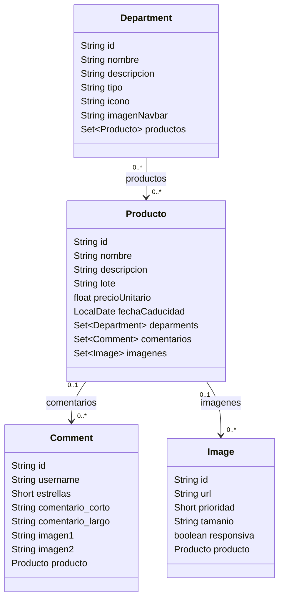

# Spring Many-to-Many

Relación muchos a muchos entre productos y categorías con Spring Boot, JPA y PostgreSQL. `Department` (categoría) es el lado propietario y define la tabla de unión `producto_deparments`.

## Entorno de desarrollo

Abre esta carpeta en VS Code y elige **Reopen in Container**. El Dev Container levanta Java 21 (servicio `app`) y PostgreSQL 16 (servicio `db`, host `db`, puerto `5432`, usuario y contraseña iniciales `postgres`). Si ejecutas la aplicación fuera del contenedor, cambia `db` por `localhost` en `application.properties`.

Primero crea el usuario y la base de datos (una sola vez):

```bash
psql -h db -U postgres -d postgres
```

```sql
CREATE USER chochos WITH PASSWORD 'chochos';
CREATE DATABASE chochos OWNER chochos;
```

Para iniciar la aplicación:

```bash
cd demo
./mvnw spring-boot:run
```

Si `./mvnw` marca `Permission denied`, ejecuta `chmod +x mvnw` o usa `sh mvnw spring-boot:run`. Si necesitas liberar el puerto `8080`: `fuser 8080/tcp` y luego `kill <PID>`.

## Estructura

```
practica-14-spring-muchos-a-muchos/
├── .devcontainer/
├── demo/src/main/java/com/example/demo/
│   ├── DemoApplication.java
│   ├── model/        (Producto, Department, Comment, Image)
│   ├── repo/         (productoRepo, categoriaRepo, comentarioRepo, imagenRepo)
│   └── controllers/  (ProductoController, CategoriaController, ComentarioController, ImagenController)
├── entregable.md     # Respuestas de las preguntas
└── README.md
```

## Pasos realizados

1. **Paso 0:** crear la base de datos `chochos` (ver *Entorno de desarrollo*).
2. **Paso 1:** crear `model/Department.java` (`@ManyToMany` con `@JoinTable`) y `repo/categoriaRepo.java`.
3. **Paso 2:** agregar a `Producto` el lado inverso `@ManyToMany(mappedBy = "productos")` con `@JsonIgnore`.
4. **Paso 3:** crear `CategoriaController`, con el endpoint `addProductoCategoria/{productId}/{categoriaId}`.
5. **Paso 4:** probar la aplicación.

## Diagrama de clases



## Endpoints

La API corre en `http://localhost:8080`. Los IDs son UUID generados automáticamente. Las rutas distinguen singular de plural.

| Método | Ruta | Función |
|---|---|---|
| `GET` | `/productos` | Lista los productos |
| `POST` | `/producto` | Crea un producto |
| `GET` / `PUT` / `DELETE` | `/producto/{id}` | Consulta, actualiza o elimina un producto |
| `GET` | `/categorias` | Lista las categorías |
| `POST` | `/categoria` | Crea una categoría |
| `POST` | `/addProductoCategoria/{productId}/{categoriaId}` | Asocia un producto con una categoría |
| `GET` | `/categoria/producto/{productId}` | Categorías de un producto |
| `GET` / `PUT` / `DELETE` | `/categoria/{id}` | Consulta, actualiza o elimina una categoría |

Para `POST` y `PUT` envía JSON con `Content-Type: application/json`; `fechaCaducidad` usa el formato `AAAA-MM-DD`.

## Probar la aplicación

1. Crear un producto y guardar su `id`:

```bash
curl --location 'http://localhost:8080/producto' \
  --header 'Content-Type: application/json' \
  --data '{"nombre":"Proteína de fresa", "descripcion":"2.2 kg", "lote":"123456", "precioUnitario":1500.5, "fechaCaducidad":"2026-05-04"}'
```

2. Crear una categoría y guardar su `id`:

```bash
curl --location 'http://localhost:8080/categoria' \
  --header 'Content-Type: application/json' \
  --data '{"nombre":"Suplementos","descripcion":"Suplementos alimenticios, vitaminas y productos naturistas","tipo":"Principal","icono":"bi bi-capsule-pill","imagenNavbar":"https://example.com/suplementos.png"}'
```

3. Relacionar ambos (sustituye `ID_PRODUCTO` e `ID_CATEGORIA` por los IDs reales, sin llaves):

```bash
curl --location --request POST 'http://localhost:8080/addProductoCategoria/ID_PRODUCTO/ID_CATEGORIA'
```

4. Revisar que exista un registro en la tabla `producto_deparments` y consultar las categorías del producto:

```bash
curl 'http://localhost:8080/categoria/producto/ID_PRODUCTO'
```

## Preguntas y respuestas

Las respuestas a las preguntas de los pasos 1 a 3 están en [`entregable.md`](entregable.md).

## Lista de comprobación

- [x] `Department` define la relación con `@ManyToMany` y `@JoinTable`
- [x] `Producto` define el lado inverso con `mappedBy` y `@JsonIgnore`
- [x] `CategoriaController` incluye el endpoint de asociación
- [x] `entregable.md` responde las preguntas del ejercicio
- [ ] Probé los endpoints y comprobé en PostgreSQL la tabla `producto_deparments`
